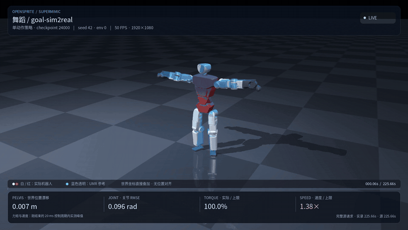

# OpenSprite Demo Tracker

[简体中文](README.md) · [OpenSprite SDK](opensprite_sdk/README.en.md)

A standalone simulation demo and development scaffold for **OpenSprite Sprite0825: 31 actuated joints and 32 link frames**. It includes raw motion, robot assets, UMR retargeting, SuperMimic-style training, evaluation, and video tools.

The current task is the complete LAFAN dance **`dance2_subject1`**: **11,284 states, 11,283 transitions, 50 Hz, and 225.66 seconds** from the first to the last sample.

## Demo and checkpoints

[](artifacts/videos/goal-sim2real-model024000-full-1080p50.mp4)

The new **`goal-sim2real / model24000`** recording is available as a [full MP4](artifacts/videos/goal-sim2real-model024000-full-1080p50.mp4), [static poster](docs/media/goal-sim2real-model024000-poster.png), and [saved rollout](artifacts/recordings/goal-sim2real-model024000/rollout.npz). The GIF joins three four-second excerpts: **0–4 s, 192–196 s, and 221–225 s**.

Seed 42, one robot: first tracking failure occurs at **193.76 s**. The same actor continues real simulation to **225.66 s**, without reset, reference wrapping or failure freeze. **The full video does not mean complete tracking success.** It contains **11,284 frames at 1080p/50 FPS**, with a **225.68 s** container duration because the final recorded state also occupies a video frame.

| Preset | Iteration | Included artifact |
|---|---:|---|
| `goal-sim2real` | 24,000 | [Checkpoint](artifacts/checkpoints/goal-sim2real_model_024000.pt) matching the new recording |
| `goal-sim` | 30,000 | [Retained training snapshot](artifacts/checkpoints/model_030000.pt) |
| `goal-sim` | 18,000 | [Checkpoint](artifacts/checkpoints/model_018000.pt) and [earlier video](artifacts/videos/dance-model018000-full-1080p50.mp4) |

Model24000 was the latest saved checkpoint selected when the recording request was first checked. It is an intermediate snapshot, not the eight-hour final checkpoint or a claim about the currently latest training checkpoint. Checkpoints and recording results are identified separately by preset and iteration.

<details>
<summary>Earlier Bilibili recording: goal-sim / model18000</summary>

[Watch goal-sim / model18000 on Bilibili](https://b23.tv/aMs7Vw3). This link shows the earlier recording, not the new goal-sim2real video.

</details>

## Method and configuration

UMR uses the included Geno FBX/skinned surface, original BVH, and official Sprite meshes. A new **4,096-slot Geno/OpenSprite correspondence** feeds the native NR surface-vector retargeter. The conversion records resampling, joint-speed refinement, FK/velocity calculation, and ground-clearance correction. The prepared training clip is `data/motions/lafan_dance.npz`.

Joint axes, masses, inertias, ranges, effort limits, and foot geometry use Sprite's own model. Both waist joints and all three head joints participate.

Training fits a world model to real simulation transitions and differentiates imagined trajectories to train the actor. It uses a SuperMimic-style model-based objective rather than PPO. This is an independent adaptation of the public methods; it does not claim to reproduce the complete official implementation or paper-scale results.

The following architecture table describes **`goal-sim`**; both presets share the simulation and update recipe. Their actor and critic differences follow below.

| Component | Configuration |
|---|---|
| Actor motion encoder | 770-dimensional future goal → **1024 / 512 / 256**, ELU → 32-dimensional tanh latent |
| Actor decoder | 10 × 105-dimensional observation history + latent32 → **1024 / 512 / 256**, ELU → 31 actions |
| Actor size | **3,226,943 parameters** |
| World model | 393 inputs → **2048 / 2048 / 2048** → 140 local state increments, SiLU + LayerNorm; **9,498,764 parameters** |
| Critic | **1268 → 256 → 128 → 1** |
| Cost heads | Two supervised heads, each **256 / 256** |
| Simulation | **768 environments**, four **5 ms** physics substeps per **20 ms** control step |
| Collection / replay | UTD **0.4**; CPU replay **1,000 rows per environment** |
| WM update | **4 × 1,024 windows**, autoregressive **K=8**, per outer iteration |
| Actor / critic update | Actor **512 trajectories, H=32**; critic **5 epochs × 4 minibatches** |
| Warmup | **500 outer iterations = 2,000 WM updates**; actor/critic optimization starts at iteration 501 |
| Validation / precision | **24 WM optimization holdout environments**; normalization still sees all environments. AMP disabled, TF32 enabled. |
| Actuation | **Torque lag disabled**, τ=0. **Command delay retained**: 0/1 physics tick, hold probability 0.9, refreshed every four ticks. |

`goal-sim` remains the default preset. Its 105-dimensional actor observation includes a six-dimensional relative reference orientation that depends on actual world heading. The world model and critic use privileged root state, physical context, and actuator memory during training.

| Preset | Actor input | Critic main network |
|---|---|---|
| `goal-sim` (default) | 10 × 105 observations + 770 reference features | 1268 → 256 → 128 → 1 |
| `goal-sim2real` | 10 × 99 sensor observations + the same 770 reference features | Reference encoder 1024/512/256 → latent32; privileged features + latent → decoder 1024/512/256 → 1 |

`goal-sim2real` removes the relative orientation. The actor uses joint position/velocity, IMU gyro and gravity projection, and the previous action. It receives no actual global position, world orientation, or linear velocity; reference features can be computed offline. The privileged critic mirrors the actor's encoder/decoder widths, ELU activations and tanh latent32, with independent weights. The world model is used only in training and may use simulation truth.

The new actor has **3,165,503 parameters**, the critic **2,653,985**, and the unchanged world model **9,498,764**.

Physics, rewards, and failure thresholds remain unchanged: reference height error 0.17 m and squared gravity error 1.6. Real hardware still requires calibrated sensors, IMU extrinsics and reliable gravity estimation. This preset does not establish real-robot readiness. See the [preset comparison](docs/plan/goal-sim2real.md).

Actor updates backpropagate through imagined rewards, soft survival, and the critic's tail value. World-model and critic parameters are frozen during that update while state/action derivatives remain active. The critic fits fixed λ-return targets from the same imagined trajectories.

The current run starts all networks, optimizers, normalizers, replay, and sampler from scratch. Its budget is **8 hours**, with a 28,620-second soft stop and 28,800-second hard cap. Ordinary resumes retain the budget. Checkpoints restore learned state, optimizers, normalization, and sampling estimates; RNG, replay, and live simulation state are rebuilt.

## Install

Use Linux, Python 3.12, and an NVIDIA driver compatible with the CUDA 12.8 PyTorch wheels. Run commands from the repository root. **Pull Git LFS before loading large assets or checkpoints.**

```sh
git lfs install
git lfs pull
uv venv --python 3.12 .venv
uv pip install --python .venv/bin/python -r requirements-lock.txt
.venv/bin/python scripts/demo.py check
```

Evaluation uses MuJoCo Warp/mjlab. Rendering uses the saved rollout and MuJoCo/EGL with FFmpeg; install `fonts-noto-cjk` for the Chinese HUD on Debian/Ubuntu. It does not rerun physics. The CPU installation check identifies missing packages, assets, Git LFS pointers, and rendering dependencies.

## Evaluate and record

Evaluate the new `goal-sim2real / model24000` snapshot:

```sh
.venv/bin/python scripts/demo.py evaluate \
  --checkpoint artifacts/checkpoints/goal-sim2real_model_024000.pt \
  --motion data/motions/lafan_dance.npz \
  --num-envs 3 --seed 42 --output outputs/demo/eval-goal-sim2real-model024000
```

Standard evaluation requests all 11,283 transitions from the first source frame. It stops early if every instance fails. A truncated diagnostic is not complete-motion success.

Rerun its recording protocol and render the complete video:

```sh
.venv/bin/python scripts/demo.py record \
  --checkpoint artifacts/checkpoints/goal-sim2real_model_024000.pt \
  --motion data/motions/lafan_dance.npz \
  --num-envs 1 --seed 42 --output outputs/demo/record-goal-sim2real-model024000
```

`record` uses **`--continue-after-failure`** for real policy simulation and **`--include-post-failure`** for rendering. First failure remains sticky. Standard scores include the first failure transition and exclude later transitions. The HUD labels continued post-failure motion. Numerical differences across hardware or dependency versions may affect reruns.

The CLI defaults remain `goal-sim / model30000` for evaluation and `goal-sim / model18000` for recording. Select the new checkpoint explicitly as above. Each demo command accepts `--dry-run` to show its arguments without GPU execution. Use a new output directory for each experiment. To re-render the [new full rollout](artifacts/recordings/goal-sim2real-model024000/rollout.npz) without running the actor or physics:

```sh
.venv/bin/python -m opensprite_tracker.supermimic.render \
  --rollout artifacts/recordings/goal-sim2real-model024000/rollout.npz \
  --model assets/opensprite/opensprite.xml --output outputs/demo/rerender-goal-sim2real-model024000 \
  --include-post-failure --failure-hold-seconds 0 --width 1920 --height 1080 --fps 50
```

## Rebuild from raw motion

The repository includes the original dance BVH and source license, Geno FBX/stance, Sprite assets, learned correspondence, and native UMR code. It needs no sibling checkout or research cache. UMR uses a separate Python environment and Node.js 18+:

```sh
uv venv --python 3.12 .venv-umr
uv pip install --python .venv-umr/bin/python -r requirements-umr.txt
npm ci --ignore-scripts --prefix third_party/umr/scripts
npm run check --prefix third_party/umr/scripts
.venv/bin/python scripts/demo.py check --profile all
```

The checked-in Three.js 0.165.0 parser subset needs no downloaded npm runtime packages. More commands and output layouts are in [Reproduction](docs/reproduce.md). A three-frame CPU check is available with `scripts/demo.py retarget --max-frames 3` and a separate output/cache directory. Partial results are diagnostic and cannot become a production motion.

Rebuild the complete dance and its single-clip bank:

```sh
.venv/bin/python scripts/demo.py retarget
.venv/bin/python scripts/demo.py build-motion
```

These commands use the bundled correspondence. Native retargeting runs on CPU; no GPU correspondence training is started implicitly. The resulting bank is `outputs/rebuild-dance/motions/lafan_dance.npz`. Intermediate solver output and source cache remain in separate output directories. A changed source/cache mismatch is rejected.

Optional fresh correspondence training is explicit: select a fresh `--correspondence-dir` with `retarget --stage all`. The lower-level entry `scripts/retarget_lafan.py` supports `--motion dance2_subject1`, separate native/cache/motion-output directories, and individual build/train/retarget/convert stages.

## Train

Start a new eight-hour run using the rebuilt motion:

```sh
.venv/bin/python scripts/demo.py train \
  --motion outputs/rebuild-dance/motions/lafan_dance.npz \
  --output outputs/demo/my-dance-training --hours 8

# Start the sensor-only actor preset with a separate cold budget.
.venv/bin/python scripts/demo.py train --preset goal-sim2real \
  --output outputs/demo/my-dance-sim2real --hours 8
```

Use `data/motions/lafan_dance.npz` to train on the included prepared clip instead. The default preset remains `goal-sim`. Each command creates a fresh configuration and budget ledger inside a new output directory and records the current Git commit. Launch and recovery require that commit and clean tracked source files; output artifacts are excluded. `--dry-run` remains available before committing edits. The supervisor checkpoints at update boundaries and preserves cumulative time across ordinary recovery. Full retargeting and tracker training require substantial computation; three-frame checks validate installation, not tracking quality.

## Limitations

The new `goal-sim2real / model24000` recording first fails at 193.76 s. Applied effort saturation, joint overspeed and global drift remain relevant limitations. Raw PD torque requests and clipped applied effort are distinct; a large request does not show an actual effort-limit violation. URDF velocity values inform reference constraints and soft penalties; they do not impose a hard simulation speed cap. See the [hardware-limit audit](docs/hardware-limits.md).

The reference retains `needs_review`: its worst self-penetration is about **4.37 cm**, with **14 frames exceeding 3 cm**. Small WM loss, short-horizon prediction accuracy, a plausible GIF, or a full-length continued video does not establish successful 225-second tracking. No real-robot deployment has been validated.

## Sources and licenses

Public sources: [OpenSprite](https://github.com/BeijingDynamics/open_sprite), [Unified Motion Retargeting](https://arxiv.org/abs/2609.02134) and [UMR code](https://github.com/hanyang9/UMR), [SuperMimic](https://arxiv.org/abs/2610.28480), and [OrangeDuck LAFAN re-solve](https://github.com/orangeduck/lafan1-resolved).

Project code is distributed under [AGPL-3.0](LICENSE). [Third-party notices](THIRD_PARTY_NOTICES.md), including MIT copyright/license text, remain intact. **LAFAN data is not relicensed under AGPL.** Its [CC BY-NC-ND 4.0 license](data/sources/lafan1-resolved/license.txt), [source information](data/sources/lafan1-resolved/README.md), and [Geno asset license](assets/geno/license.txt) apply separately.
