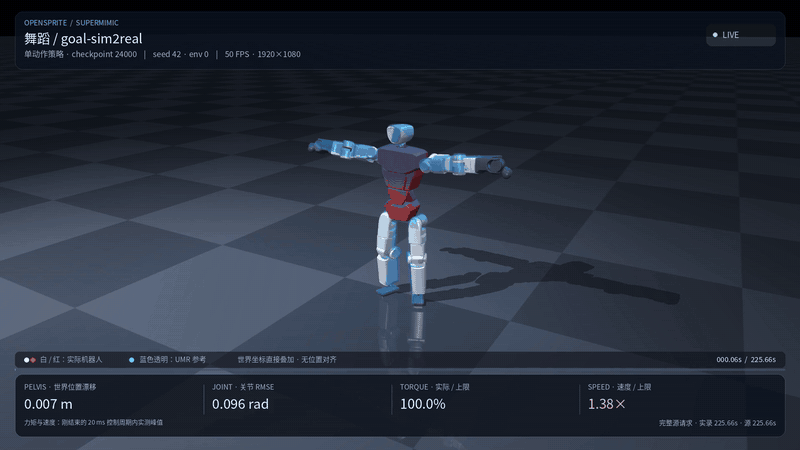

# OpenSprite Demo Tracker

[English](README.en.md) · [OpenSprite SDK 子工程](opensprite_sdk/README.md)

这是给 [OpenSprite](https://github.com/BeijingDynamics/open_sprite) 做的动作跟踪 demo，也是一套可以接着开发的脚手架。当前只训练 LAFAN 中一条 **225.66 秒的长舞蹈 `dance2_subject1`**：用 UMR 做机器人动作 retargeting，用 SuperMimic 方法训练，在 MuJoCo Warp 中仿真并生成视频。

仓库包含原始舞蹈、人体与机器人资产、retarget 代码和结果、训练配置、模型快照及示例视频。拉全 Git LFS 文件并安装依赖后，可以独立完成这条流程，不依赖其他项目目录。

## 视频与模型

[](artifacts/videos/goal-sim2real-model024000-full-1080p50.mp4)

最新录像为 **`goal-sim2real / 24000轮`**：[完整MP4](artifacts/videos/goal-sim2real-model024000-full-1080p50.mp4)、[静态封面](docs/media/goal-sim2real-model024000-poster.png)和[原始仿真轨迹](artifacts/recordings/goal-sim2real-model024000/rollout.npz)。动图节选0–4秒、192–196秒和221–225秒，有跳剪。

录像使用seed42、单实例，在 **193.76秒**首次判失败，之后同一策略继续真实仿真到225.66秒，没有重置、参考循环或停帧。**完整视频不代表整段跟踪成功。** 视频为1080p、50fps，共11284帧；容器时长225.68秒，包含最后一个源状态的显示时长。

| 配方 | 轮次 | 发布内容 |
|---|---:|---|
| `goal-sim2real` | 24000 | [对应新录像的快照](artifacts/checkpoints/goal-sim2real_model_024000.pt) |
| `goal-sim` | 30000 | [保留的训练快照](artifacts/checkpoints/model_030000.pt) |
| `goal-sim` | 18000 | [快照](artifacts/checkpoints/model_018000.pt)与[原演示视频](artifacts/videos/dance-model018000-full-1080p50.mp4) |

24000轮是首次检查这次录像请求时选定的最新已保存中间快照，不是八小时最终模型。各快照与录像均单独标注配方和轮次。

<details>
<summary>goal-sim / 18000轮：B站完整在线播放</summary>

[▶ Open sprite robot / umr / supermimic / lafan dance（哔哩哔哩）](https://b23.tv/aMs7Vw3)。这个链接对应原演示，不是上方新录的goal-sim2real视频。

</details>

目前高动态跟踪还不理想。**部分关节在部分时刻已经吃满力矩上限，腾空等动作还是没跟上。** 视频里也能看到世界坐标漂移。实际施加力矩受到effort限幅；未限幅的PD请求大于上限，不等于实际输出超过上限。

## 安装与快速运行

环境为Linux、Python 3.12、CUDA 12.8；本实验使用RTX 5080 Laptop 16GB。视频需要FFmpeg/ffprobe，retarget需要Node.js 18或更新版本。模型和MP4使用Git LFS。

```bash
git clone https://github.com/lzjever/opensprite-tracker.git
cd opensprite-tracker
git lfs install --local
git lfs pull

uv venv --python 3.12 .venv
uv pip install --python .venv/bin/python -r requirements-lock.txt
.venv/bin/python scripts/demo.py check
```

检查命令只做CPU和文件检查。模型若还是几行pointer文本，先运行`git lfs pull`。

评估发布快照，从第一帧请求完整舞蹈：

```bash
.venv/bin/python scripts/demo.py evaluate \
  --checkpoint artifacts/checkpoints/goal-sim2real_model_024000.pt \
  --output outputs/my-evaluation
```

按示例协议重新仿真并录制完整视频，失败后继续运行：

```bash
.venv/bin/python scripts/demo.py record \
  --checkpoint artifacts/checkpoints/goal-sim2real_model_024000.pt \
  --output outputs/my-recording
```

上述命令显式选择新录像对应的快照。CLI默认仍为`goal-sim`：评估用30000轮快照、seed42、三个实例；录制用18000轮快照、seed42、单实例。包装脚本显式使用本仓库的动作和机器人资产，覆盖快照中的历史绝对路径。

从头训练自己的版本：

```bash
.venv/bin/python scripts/demo.py train --output outputs/my-dance --hours 8

# Actor仅使用关节传感器和IMU观测的独立配方
.venv/bin/python scripts/demo.py train --preset goal-sim2real \
  --output outputs/my-dance-sim2real --hours 8
```

默认配方为`goal-sim`；`goal-sim2real`生成另一套独立配置和账本，从零开始。正式启动要求已跟踪源码干净，并固定当前Git提交；`--dry-run`可在修改尚未提交时查看命令。普通训练不依赖Codex；CLI小时审查是单独的可选工具。

## 从原始舞蹈重新retarget

[原始BVH](data/sources/lafan1-resolved/dance2_subject1.bvh)、[Geno模型与站姿](assets/geno/)、[OpenSprite资产](assets/opensprite/)和[UMR表面对应资产](assets/umr_correspondence/geno_opensprite0825/)均已包含。对应点、骨架和约束按OpenSprite的31关节、32 link构建。

retarget使用独立环境：

```bash
uv venv --python 3.12 .venv-umr
uv pip install --python .venv-umr/bin/python -r requirements-umr.txt
.venv/bin/python scripts/demo.py check --profile all

# 使用已有表面对应，重新优化原始舞蹈，再转换成训练动作库
.venv/bin/python scripts/demo.py retarget --motions dance2_subject1
.venv/bin/python scripts/demo.py build-motion
```

从对应数据构建和网络训练一起重做：

```bash
.venv/bin/python scripts/demo.py retarget --stage all --motions dance2_subject1 \
  --correspondence-dir outputs/my-correspondence
```

原生UMR优化、FBX读取代码和所需JavaScript文件都在仓库内。新生成的文件默认放在`outputs/rebuild-dance`，完整重建后训练时指定生成的motion路径。详细命令、目录和分阶段用法见[独立复现说明](docs/reproduce.md)。

## 网络与训练逻辑

| 模块 | 设计 |
|---|---|
| Actor | 770维未来参考经`1024→512→256→32`编码，latent使用tanh；与10×105维观测历史拼接后，经`1024→512→256→31`解码；ELU，约323万参数 |
| 世界模型 | 393维输入，`2048×3`隐藏层，SiLU和LayerNorm，预测140维局部状态增量；约950万参数 |
| Critic | `1268→256→128→1` |
| 成本预测 | 两个256/256隐藏层head，监督真实子步速度、力矩和接触指标 |

上表为`goal-sim`的结构。它的105维Actor观测包含关节位置/速度、IMU角速度和重力方向、上一步动作与6维参考相对姿态；最后一项依赖实际世界heading。

| 配方 | Actor输入 | Critic主网络 |
|---|---|---|
| `goal-sim`（默认） | 10×105维历史 + 770维参考 | 1268→256→128→1 |
| `goal-sim2real` | 10×99维传感器历史 + 同一770维参考 | 参考编码1024/512/256→latent32；特权特征与latent经1024/512/256→1 |

新配方移除6维参考相对姿态，保留关节位置/速度、IMU gyro/重力投影和前次动作。Actor不读取实际全局位置、世界姿态或线速度；参考目标可离线计算。Critic允许全局特权，与Actor采用相同编码器/解码器宽度、ELU及latent32结构，参数各自独立。WM只用于训练，可用仿真真值。

新配方Actor为3,165,503参数、Critic为2,653,985参数；两种配方的世界模型均为9,498,764参数。

两种配方保持奖励、参考高度误差0.17m及重力平方误差1.6的失败标准。真实机器人仍需可靠的重力估计、传感器标定和IMU外参；`goal-sim2real`尚不代表已验证实机部署。详见[配方对比](docs/plan/goal-sim2real.md)。

真实仿真转移进入replay，世界模型做K=8自回归监督。Actor从真实状态出发展开H=32想象轨迹，通过奖励、软存活权重和critic尾值做BPTT。Actor更新时冻结世界模型和critic参数，保留状态与动作的导数。Critic用同批轨迹的固定λ-return目标拟合。

| 当前训练配方 | 数值 |
|---|---|
| 预算 | 八小时；GPU设置、编译、预热和恢复计入，普通resume不刷新 |
| 仿真/控制 | 5ms物理步，4个子步一次动作，200Hz/50Hz |
| 并行环境/replay | 768env，CPU replay每env1000行，UTD=.4 |
| 预热 | 500个outer只更新WM及成本head，各2000次Adam；随后联合训练 |
| 联合更新 | 每outer WM 4×1024个K8窗口；actor一次512条H32轨迹；critic 5×4次Adam |
| 优化 | lr=2e−4，γ=.99，λ=.95；AMP关闭、允许TF32 |
| 执行器 | OpenSprite自己的PD和effort限制；无一阶力矩迟滞，保留0/1个5ms tick命令延迟、每4tick刷新、hold概率.9 |

训练使用单条舞蹈，50Hz、11284个状态、11283次转移。reset按动作内部相位采样，混合均匀、低回报和历史分布。24个env不参与WM优化采样，但归一化仍看全部env。

## 已知问题与后续开发

- 腾空和接触切换仍会失败。力矩饱和后，继续增大策略输出没有增加实际可用力矩；参考高度、接触时序和动力学可行性需要一起检查。
- 局部姿态更接近参考时，世界坐标漂移仍可能变大。相对身体误差、根部漂移和最差片段需要分别评估。
- 速度超限、关节限位残留尚未消除。effort限幅不能代替速度和接触检查。
- retarget结果保留`needs_review`：舞蹈有14帧局部自穿超过3cm，最深约4.37cm。数据可加载不等于动作已被证明动力学可行。
- 短窗WM误差低，不代表H32想象和225秒闭环都可靠。microbatch只切分计算，不增加Adam步数。
- checkpoint保存模型、Adam、归一化和采样统计；replay、RNG和live simulator状态会重建，恢复不是逐位无损续跑。

后续建议先固定完整源评估基线，再做受控对照。优先检查193秒附近的腾空/落地，校准足部尺度相关奖励，补充临界接触状态的采样覆盖，并验证长rollout误差。机器人侧需要继续做PD、传感器零偏、命令延迟和扭矩—速度能力的实际辨识。这些工作可以直接沿用现有retarget、训练、评估和视频入口。硬件上限的来源、实际限幅与未建模能力见[硬件约束说明](docs/hardware-limits.md)。

## 方法与许可

动作重定向采用 [UMR](https://arxiv.org/abs/2609.02134)，训练采用 [SuperMimic](https://arxiv.org/abs/2610.28480) 方法。本仓库实现包含可选真实子步成本预测和上述训练配方。

本项目代码框架采用 **GNU AGPL v3**，与OpenSprite一致，见 [LICENSE](LICENSE)。第三方代码和机器人资产保留各自的版权与许可，见 [THIRD_PARTY_NOTICES.md](THIRD_PARTY_NOTICES.md)。LAFAN/Geno数据仍适用[原始数据许可](data/sources/lafan1-resolved/license.txt)及[Geno许可](assets/geno/license.txt)，不因代码采用AGPL而被重新授权。
