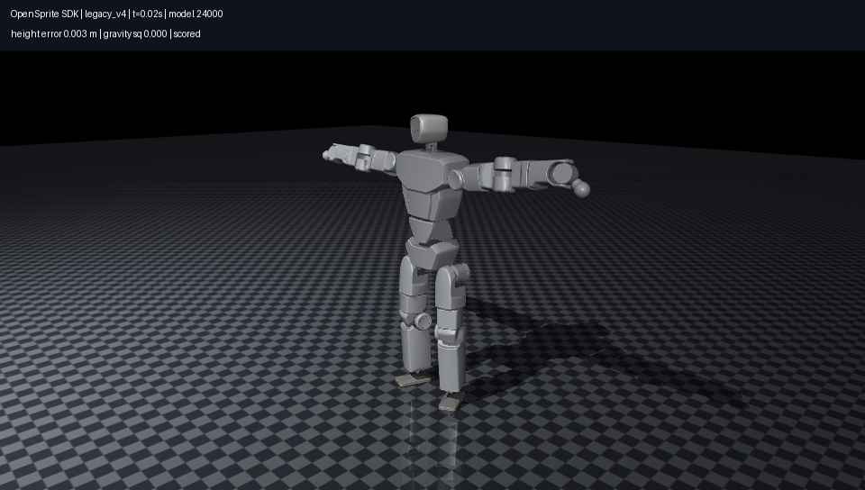

# OpenSprite SDK

[English](README.en.md)

这是一套给 OpenSprite 做控制和策略部署的独立子工程。接口沿用 Unitree SDK2 的 `ChannelFactoryInitialize`、`ChannelPublisher`、`ChannelSubscriber`、`LowCmd` 和 `LowState` 使用习惯。相同的关节命令可以接 MuJoCo 仿真或 Jetson 真机后端。

SDK 采用 OpenSprite 自己的31关节顺序和机构映射。`motor_cmd`、`motor_state` 是兼容拼写，内容仍是关节空间；左右脚踝和头部 pitch/roll 的电机转换由后端完成。当前提供进程内和本地 Unix 通信，**不与 Unitree DDS 二进制协议互通，也未提供远程 DDS 通信**。

模型、网格、原生 CAN 执行器和配置模板均在本目录。移动整个目录即可继续开发，不依赖父项目或 `.reference/`。参考仓库、模型导出产物和本地标定不提交 Git。本工程使用 AGPL-3.0-only，第三方许可见 [来源说明](THIRD_PARTY_NOTICES.md)。

## 安装与仿真

在本目录执行。Python 3.10 或以上；部署侧使用 CPU ONNX Runtime，不要求安装 PyTorch。

```bash
python3 -m venv .venv
source .venv/bin/activate
python -m pip install -e '.[sim,deploy,test]'
python -m pytest tests -q
```

分两个终端运行同一虚拟环境中的程序：

```bash
# 终端一：仿真服务，显式允许仿真使能。
python examples/sim_robot.py --endpoint /tmp/opensprite-sdk.sock \
  --domain 1 --duration 10 --enable-sim

# 终端二：相同的发布/订阅客户端，使用该仿真配方的站立增益。
python examples/low_level.py --endpoint /tmp/opensprite-sdk.sock \
  --domain 1 --duration 2 --gains-profile legacy_v4
```

客户端正常结束会请求全身失能，仿真服务确认后退出。仿真在首条命令前暂停物理时间，之后正常执行物理和超时检查。移除 `--gains-profile` 时使用低增益接口演示，不能当作自由站立参数。

## SDK 调用

```python
from opensprite_sdk.core.channel import ChannelFactoryInitialize
from opensprite_sdk.client import LowLevelClient, joint_command

ChannelFactoryInitialize(1, transport="unix", endpoint="/tmp/opensprite-sdk.sock")
with LowLevelClient() as robot:
    state = robot.Read()
    q = [joint.q for joint in state.motor_state]
    command = joint_command(state, q, kp=[2.0]*31, kd=[0.12]*31)
    robot.Write(command)
```

也可直接使用 Publisher/Subscriber 和可逐字段填写的消息，见 [接口与时间契约](docs/api.md)。发送命令不会隐式启动真机或取得使能权限。上面只是单帧低增益接口示例，持续控制需要按50Hz发送新命令。

## sim2sim：部署舞蹈策略

导出工具接受显式提供的、可信的 `goal-sim2real` checkpoint 和50Hz动作文件。它把网络、归一化、参考目标和传感器坐标约定写入独立 bundle；运行时不加载训练代码或世界模型。当前导出器支持本项目发布的旧版 v4、99维观测、10帧历史和770维目标配方。

```bash
# 导出可在开发机上完成；这里的输入路径由使用者提供。
python -m pip install -e '.[export]'
python tools/export_tracker.py \
  --checkpoint /path/to/goal-sim2real_model_024000.pt \
  --motion /path/to/lafan_dance.npz --output outputs/dance-bundle
python tools/check_bundle.py outputs/dance-bundle
python tools/benchmark_policy.py outputs/dance-bundle

# 完整参考轨迹；失败后继续实际策略和物理，结果单独记录首次失败。
python examples/run_policy.py --bundle outputs/dance-bundle \
  --backend mujoco --continue-after-failure --output outputs/full-dance
```

在当前父项目内，两个输入分别位于 `../artifacts/checkpoints/goal-sim2real_model_024000.pt` 和 `../data/motions/lafan_dance.npz`。这只是导出输入的例子，SDK 运行时不读取父目录。

录像示例：

```bash
# Linux 无显示器时，可用 OSMesa 在 CPU 渲染；需系统已安装 libosmesa6。
MUJOCO_GL=osmesa python examples/run_policy.py --bundle outputs/dance-bundle \
  --backend mujoco --duration 2 --video --continue-after-failure \
  --output outputs/dance-video
```

`legacy_v4` 保留200Hz物理、50Hz策略、命令延迟和关闭一阶力矩迟滞的配置。`runtime_timing_v4` 仅用于500Hz执行时间表实验，仍是旧版刚体资产，不能当作新肩部电机的完整真机模型。策略和 profile 不匹配时拒绝运行。



## sim2real：Jetson 后端

目标主控为 NVIDIA Jetson Orin Nano Super Developer Kit。SDK 自带 Linux C++ CAN 层、ICM SPI 读取器、逐机配置校验和生成工具。完整构建、标定项、shadow/上电流程及退出报告见 [Jetson 部署说明](docs/hardware.md)。

```bash
bash tools/build_native.sh
ctest --test-dir build/native --output-on-failure
cp config/hardware.jetson.example.json config/hardware.local.json
```

模板中的逐机参数留空，必须按实际机器人填写。完整部署入口是 `examples/deploy_jetson.py`，它先预检，再启动有限时原生进程并核验最终报告。`examples/hardware_robot.py` 将已启动的原生进程接到与仿真相同的 SDK 通道；`examples/low_level.py` 可连接该服务。`examples/run_policy.py --backend hardware` 提供匹配策略的 shadow/部署入口。

当前舞蹈 bundle 属于旧版 v4，未通过新版真机验收，不能直接用于新版四肩 J4340P 配置上电。BOM 标注的 USB IMU 与公开 runtime 的 SPI 读取方式也有差异；当前提供已公开的 SPI 实现和明确的 IPC 接口，USB 模块协议仍需确认。

## 验证与开发

实施计划、team 交叉审查及实际验收结果分别放在 [docs/plan](docs/plan/implementation.md) 和 [验收记录](docs/validation.md)。软件已验证范围包括真实 CPU MuJoCo、跨进程通信、ONNX 数值对照、完整225.66秒舞蹈、C++ 编译、故障注入和假硬件对端。Jetson ARM64、真实 CAN/IMU 接线、上电和时延尚未实测。

之后可直接把本目录拆成新仓库。拆分前运行 `python tools/check_standalone.py` 检查发行文件、wheel资产和独立运行。
